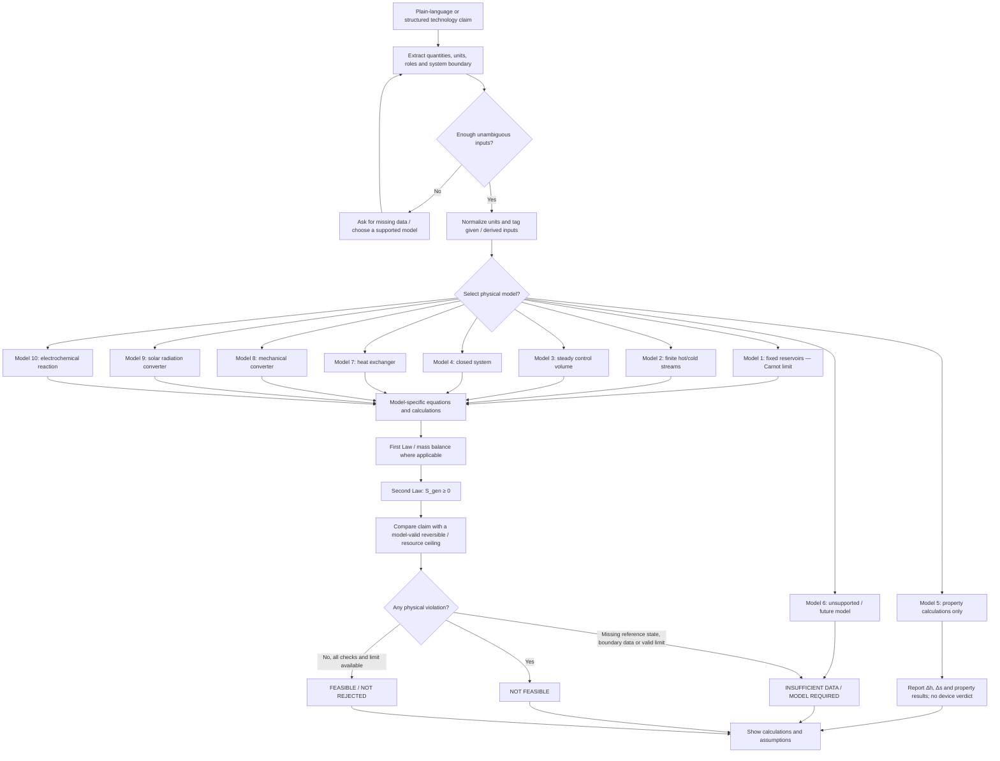

# Thermodynamic Feasibility Tester — updated calculation flow

## Model-specific checks added in this revision

### Model 3 — steady control volume

1. Mass balance: `Σṁ_in − Σṁ_out = 0`.
2. Energy balance: `Q̇_in − Ẇ_out + Σṁ_in e_in − Σṁ_out e_out = 0`.
3. Entropy balance: `Ṡ_gen = Σṁ_out s_out − Σṁ_in s_in − Σ(Q̇_j/T_b,j) ≥ 0`.
4. Flow exergy: `ψ = (h − h0) − T0(s − s0) + V²/2 + gz`.
5. Reversible shaft-work ceiling: `Ẇ_rev = Σṁ_in ψ_in − Σṁ_out ψ_out + Σ[Q̇_j(1 − T0/T_b,j)]`.
6. Exergy destruction: `Ė_destroyed = T0 Ṡ_gen`.

Each stream needs dead-state `h0` and `s0`, and the case needs `T0`. The present model accounts for physical flow exergy only; chemical and mixing exergy are not included. If the reference data is absent, the system reports insufficient data rather than claiming feasibility.

### Model 4 — closed system

1. First Law: `Q − W_total − ΔE = 0`.
2. Entropy: `S_gen = ΔS_system − Σ(Q_j/T_b,j) ≥ 0`.
3. Non-flow exergy: `B = E + p0 V − T0 S`.
4. Useful work: `W_useful = W_total − p0 ΔV`.
5. Reversible useful-work ceiling: `W_useful,rev = −ΔB + Σ[Q_j(1 − T0/T_b,j)]`.

The reference environment `T0`, `p0`, and system volume change `ΔV` are required for a reversible useful-work comparison. The engine continues to report insufficient data if they are absent.

### Model 8 — mechanical-to-electrical converter

1. Input: `P_mech = E_event × event_rate`, or a directly supplied mechanical power.
2. First Law: `P_mech,in − P_electric,out − Q̇_rejected = 0`.
3. For a steady lumped converter with one heat-rejection boundary: `Ṡ_gen = Q̇_rejected/T_rejection ≥ 0`.
4. Resource ceiling: `P_electric,out ≤ P_mech,in`.

If positive heat rejection is inferred or supplied, its boundary temperature is needed to evaluate entropy generation. A missing temperature produces an insufficient-data verdict; an output above mechanical input is rejected immediately.

### Model 9 — solar radiation converter

1. Incident radiation: `Q̇_rad = G A`.
2. Petela–Landsberg fraction: `η_L = 1 − (4/3)(T0/Ts) + (1/3)(T0/Ts)^4`.
3. Radiation exergy input: `Ė_rad = η_L Q̇_rad`.
4. Under the current lumped assumption that all unconverted radiation energy is rejected as heat to ambient: `Q̇_rad − Ẇ_electric − Q̇_rejected = 0`.
5. Exergy / entropy balance: `Ṡ_gen = (Ė_rad − Ẇ_electric)/T0 ≥ 0`.

This is an ideal undiluted-blackbody upper-bound model, not a detailed photovoltaic or solar-thermal component model. Real sunlight at Earth is diluted; users must not interpret this ideal ceiling as a panel prediction.

### Model 10 — electrochemical converter

1. Reaction entropy: `ΔS_rxn = (ΔH_rxn − ΔG_rxn)/T_reaction`.
2. First Law: `Q̇_into − Ẇ_electric,out − ΔH_rxn ṅ_rxn = 0`.
3. Entropy generation: `Ṡ_gen = ΔS_rxn ṅ_rxn − Q̇_into/T_reaction ≥ 0`.
4. Reversible non-expansion work: `Ẇ_rev = −ΔG_rxn ṅ_rxn`.
5. Claim limit: `Ẇ_electric,out ≤ Ẇ_rev`.

The current Gibbs model requires ΔG, ΔH, reaction rate, reaction temperature, signed heat interaction and heat-boundary temperature. It assumes heat crosses the boundary at the reaction temperature (isothermal basis). A different heat-boundary temperature requires a more detailed reactor exergy model and is rejected as unsupported by this simplified model.

## Verdict meanings

- **NOT FEASIBLE**: a mass/energy balance fails, entropy generation is negative, or the claimed output exceeds the applicable model limit.
- **FEASIBLE / NOT REJECTED**: the applicable balances pass and a valid reversible/resource ceiling is available and not exceeded.
- **INSUFFICIENT DATA / MODEL REQUIRED**: a required reference state, heat-boundary condition, balance term, or validated model is missing.

A thermodynamic pass is not proof of engineering buildability, economic viability, safety, or commercial performance.
